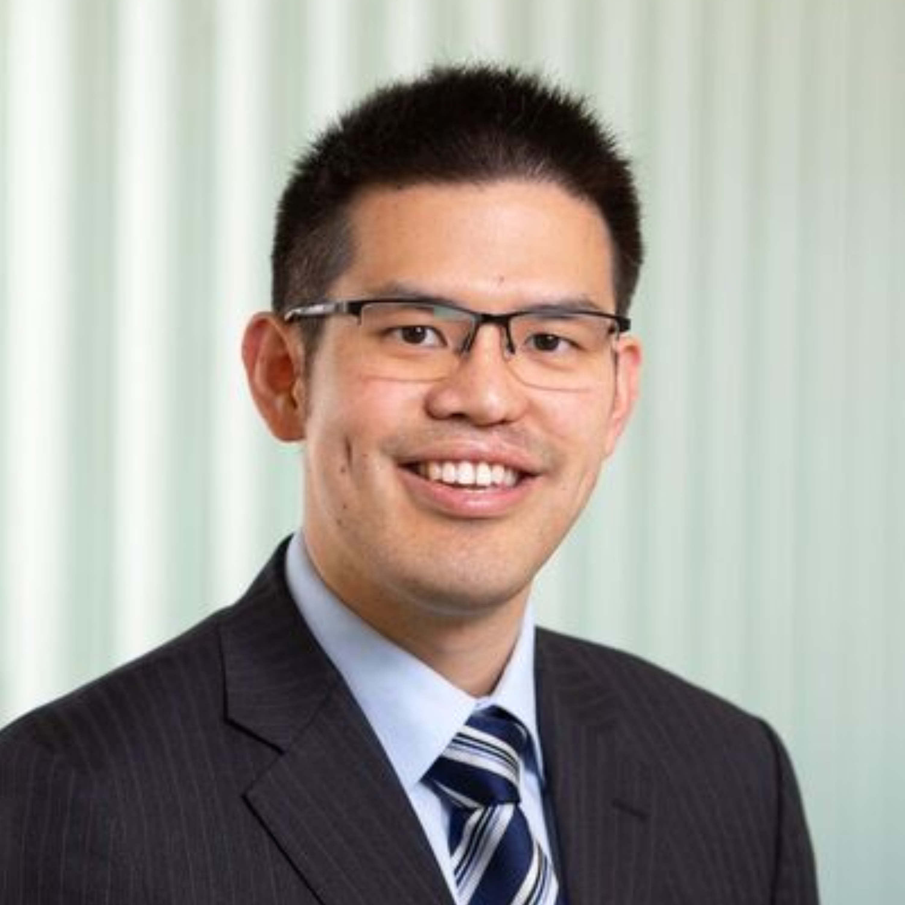

:::: {.grid}

::: {.g-col-4}
{.roundedimg width=2.5in fig-align="left"}

**Laboratory Head & Senior Research Fellow**  
Monash University, Melbourne, Australia

**Genitourinary Cancer Medical Oncologist**  
Eastern Health, Melbourne, Australia

   
  <a href="https://scholar.google.ca/citations?hl=en&user=FU67caEAAAAJ">Google Scholar</a>

   
  <a href="https://x.com/EdmondMKwan">Twitter / X</a>

   
  <a href="https://orcid.org/0000-0002-7053-680X">ORCID</a>

   
  <a href="https://www.ncbi.nlm.nih.gov/myncbi/1RQvgzm6zlL5y/bibliography/public/">PubMed</a>

  
  <a href="pdfs/2026-10-28_CV_EdmondKwan.pdf">Curriculum vitae</a>

   
  <a href="mailto:edmond.kwan@monash.edu">Contact me</a>

:::

::: {.g-col-8}
## About me

I am a clinician-scientist and genitourinary cancer medical oncologist at Eastern Health in Melbourne, Australia. I lead a translational research laboratory as Laboratory Head and Senior Research Fellow at the Eastern Health Clinical School, Monash University, with a cross-appointment within the Biomedicine Discovery Institute Prostate Cancer Research Group.

After completing my specialist training, I undertook a PhD at Monash University, supported by an NHMRC Postgraduate Scholarship, studying whole blood RNA to characterise aggressive molecular subtypes of prostate cancer. I then moved to Vancouver, Canada, for a genitourinary clinical fellowship at BC Cancer and a postdoctoral fellowship at the Vancouver Prostate Centre, University of British Columbia. There I developed tissue and circulating tumour DNA biomarkers to predict treatment outcomes in lethal metastatic prostate cancer, using samples from prospective clinical trials and large biobanks. I returned to Australia in October 2024 to begin my independent research career.

I am a Principal Investigator on early and late-phase urological cancer clinical trials and Assistant Chair of ANZUP's Translational Research Subcommittee. Drawing on cancer genomics and clinical oncology, my team aims to bring liquid biopsy into clinical practice, using genomic and epigenomic alterations in tumour tissue and blood to better guide treatment decisions for patients with urological cancers.

:::

::::